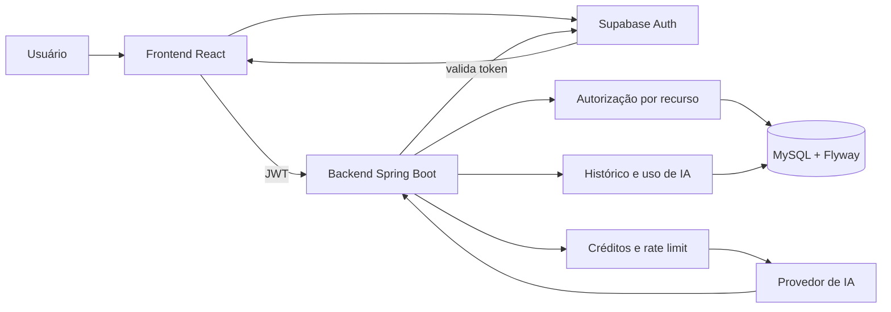

# Arquitetura do NovelCopilot

## Fronteiras

- O frontend controla apresentação, sessão no navegador e edição local.
- O Supabase autentica; o backend não armazena senhas.
- O backend é a autoridade para acesso, contexto narrativo, cotas de IA e chamadas
  externas.
- O MySQL é a fonte persistente; Flyway é a fonte do schema.
- Provedores de IA não recebem credenciais do usuário nem decidem cobrança.

## Fluxo autenticado

1. O frontend obtém a sessão no Supabase.
2. `authenticatedFetch` envia o bearer token.
3. O backend valida o token e cria/atualiza o perfil local quando necessário.
4. O acesso ao recurso é verificado usando o usuário autenticado.
5. Um recurso inexistente ou pertencente a outro usuário responde 404 para não
   revelar sua existência.
6. Um token inválido ou expirado responde 401; o frontend limpa a sessão e leva o
   usuário à autenticação, preservando um retorno seguro quando aplicável.

## Fluxo de IA

1. O backend valida história e capítulo.
2. Seleciona contexto relevante dentro dos limites configurados.
3. Valida preço, saldo e rate limit e reserva créditos.
4. Chama o provedor configurado.
5. Valida e normaliza a resposta.
6. Captura o custo em sucesso ou libera a reserva em falha.
7. Registra uso e histórico por capítulo quando aplicável.

O benchmark usa a mesma infraestrutura de provedores, mas possui perfil,
permissão administrativa e tetos financeiros próprios.
